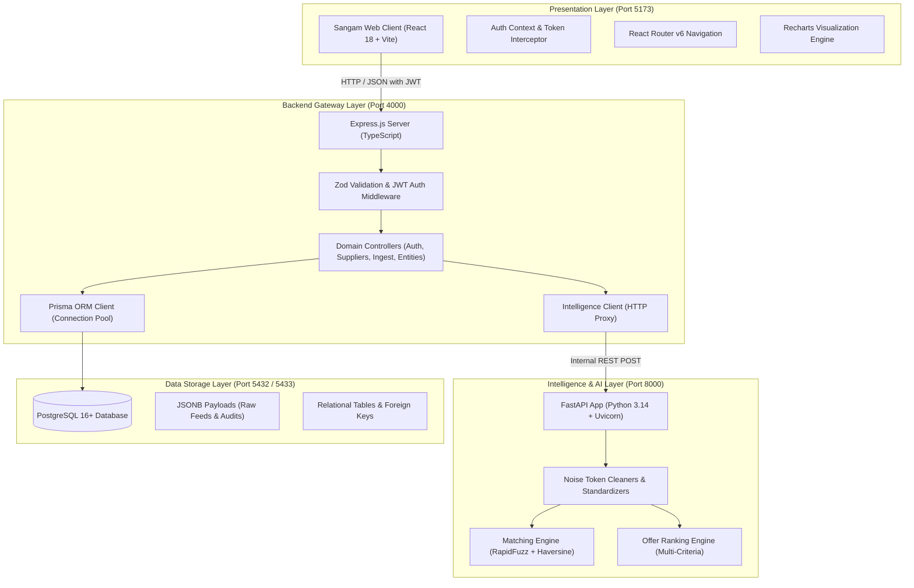
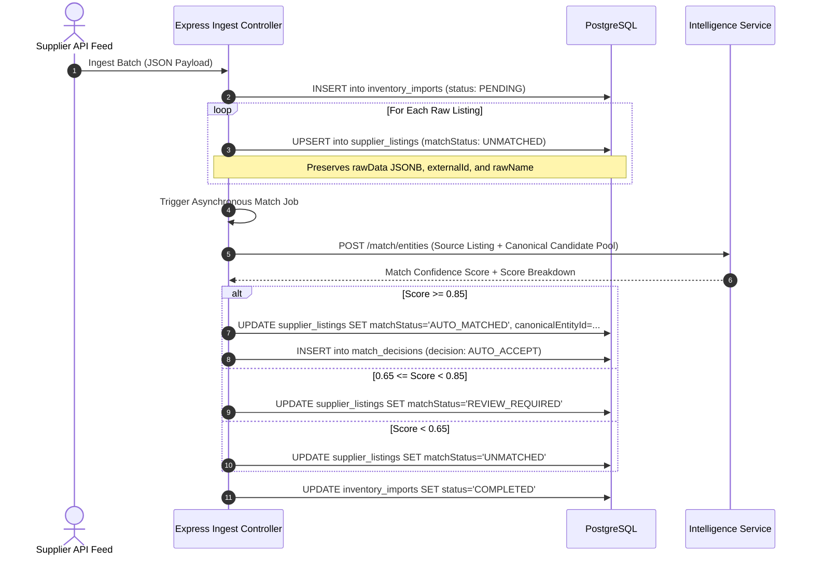
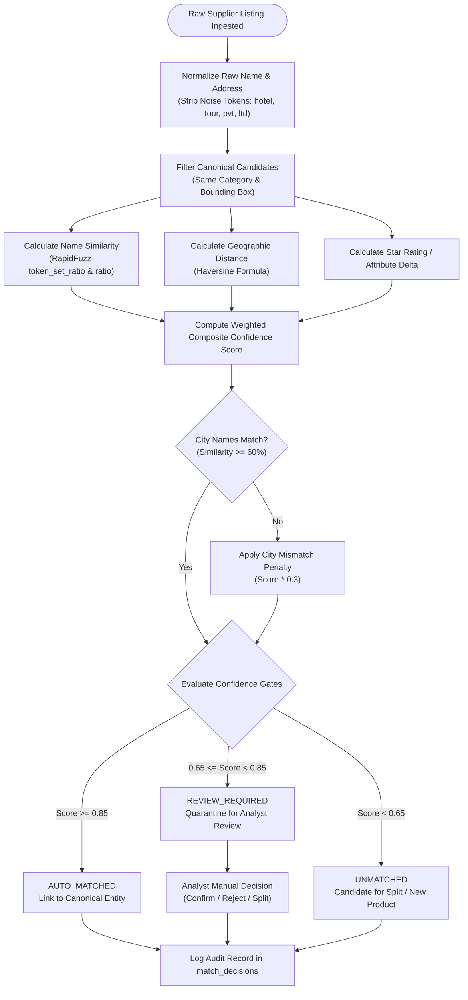
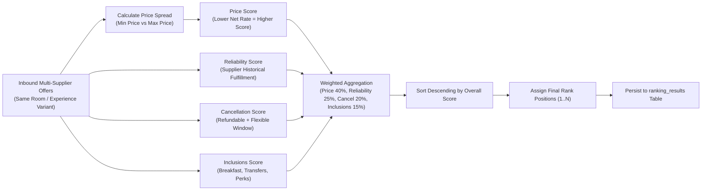
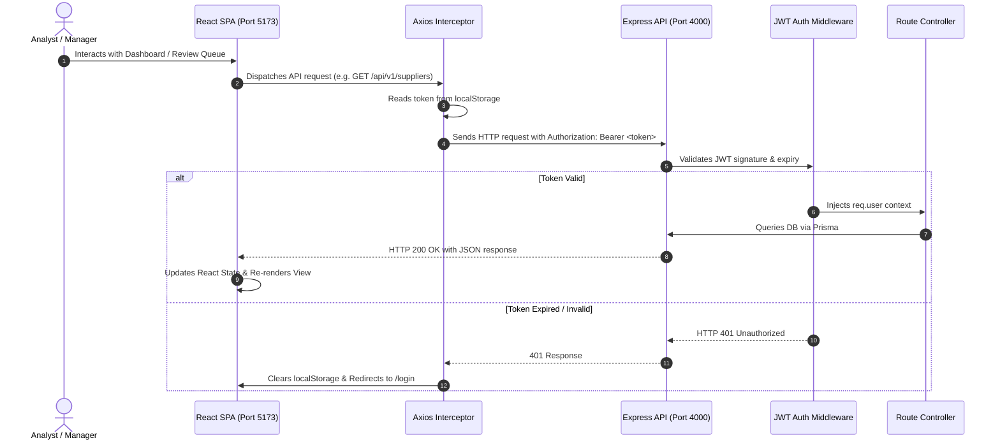

# System Architecture Document — SANGAM

**Product Name:** Sangam  
**Tagline:** Where Travel Inventory Comes Together  
**Document Version:** 1.1.0  
**Status:** Implemented (Core Foundation) / Expanding (Enterprise Scale)  
**Last Updated:** November 2026  
**Related Documents:** [PRD.md](PRD.md) • [DATABASE.md](DATABASE.md) • [API.md](API.md) • [AI_ENGINE.md](AI_ENGINE.md)

---

## 1. Architectural Overview & Design Philosophy

Sangam is architected as a modular monorepo composed of three decoupled core services:
1. **Frontend Client (`/client`):** High-performance Single Page Application (SPA) built with React 18, Vite, TypeScript, and Tailwind CSS.
2. **Backend API Gateway (`/server`):** Node.js and Express.js REST application operating as the business logic, authentication, ingest coordinator, and database layer via Prisma ORM.
3. **Intelligence Microservice (`/intelligence`):** High-throughput Python FastAPI microservice specializing in data normalization, fuzzy token matching (RapidFuzz), geospatial calculations (Haversine), and multi-criteria offer ranking.



---

## 2. Component Architectures

### 2.1 Frontend Client Architecture (`client/`)
The frontend is constructed with enterprise B2B SaaS design standards:
- **State Management & Routing:** Handled via React Router v6 with a centralized `AuthProvider` (`client/src/context/AuthContext.tsx`). Unauthenticated requests automatically redirect to `/login`.
- **API Communication:** Axios instance (`client/src/services/api.ts`) with request interceptors that inject `Authorization: Bearer <token>` and response interceptors that manage token expiration ($401$ status).
- **Component Hierarchy:**
  - `components/common/`: Domain-agnostic components (`Badge`, `Button`, `Card`, `Modal`).
  - `layouts/MainLayout.tsx`: Collapsible enterprise sidebar, top status bar showing microservice health, user profile dropdown.
  - `pages/`: 10 route-level pages (`DashboardPage`, `SuppliersPage`, `InventoryPage`, `HotelsPage`, `SightseeingPage`, `MatchReviewPage`, `OfferComparisonPage`, `AnalyticsPage`, `SettingsPage`, `LoginPage`).
- **Styling Architecture:** Custom Tailwind CSS theme extending deep navy (`#0B192C`), rich teal accents (`#0D9488`), and neutral slate borders (`#E2E8F0`).

### 2.2 Express Backend Gateway Architecture (`server/`)
The backend is structured into domain-driven modules inside `server/src/modules/`:
- `auth/`: User registration, login with bcrypt password comparison, session profiling.
- `suppliers/`: Supplier feed registry, reliability score management, feed configuration.
- `imports/`: Batch inventory ingest lifecycle management (`PENDING` $\to$ `COMPLETED`).
- `inventory/`: Multi-filter querying of raw supplier inventory listings (`supplier_listings`).
- `entities/`: Canonical entity retrieval with nested supplier listings, variants, and offers.
- `matching/`: Fetching listings in review queues, applying human decisions, and triggering algorithmic matching.
- `offers/`: Generating comparison matrices across suppliers and triggering multi-criteria ranking.
- `analytics/`: Aggregate database queries computing deduplication rates and consolidation ratios.
- **Request Pipeline:**
  1. Inbound HTTP request hits CORS and Morgan logging middleware.
  2. Route handler evaluates `validateRequest(ZodSchema)` middleware.
  3. Optional `requireAuth` validates signed JWT bearer token.
  4. Controller executes business logic via Prisma Client or `intelligenceClient`.
  5. Unhandled exceptions bubble up to `errorHandler.ts` for standardized JSON error responses.

### 2.3 Python Intelligence Service Architecture (`intelligence/`)
Built with FastAPI to maximize computational efficiency for string matching and numeric ranking:
- **Pydantic Schemas (`app/schemas/`):** Strongly typed models for `EntityMatchRequest`, `EntityMatchResponse`, `VariantMatchRequest`, and `OfferRankingRequest`.
- **Text Normalization (`app/normalization/cleaner.py`):**
  - Lowercases, strips punctuation, collapses whitespace.
  - Removes domain-specific noise tokens (e.g., `hotel`, `resort`, `inn` for hotels; `tour`, `ticket`, `guided` for sightseeing).
  - Calculates great-circle coordinate distance via the Haversine formula.
- **Matching Engine (`app/matching/engine.py`):**
  - Token Set Ratio via RapidFuzz ($70\%$ weight) + Direct Ratio ($30\%$ weight).
  - Proximity scoring based on Haversine distance ($1.0$ if $\le 50\text{ m}$, linear decay to $0.0$ at $1.5\text{ km}$).
  - Star rating difference penalty ($0.3$ per star delta).
  - Hard city mismatch penalty: if city names differ with similarity $< 60\%$, score is penalized by $0.3\times$.
- **Ranking Engine (`app/ranking/engine.py`):**
  - Relative price score calculated against the min/max spread in the candidate pool.
  - Supplier fulfillment reliability score ($0.0 \dots 1.0$).
  - Cancellation flexibility based on refundability status and deadline hours.
  - Value of inclusions (breakfast bonus $+0.35$, airport transfers $+0.25$, perk count bonus).

---

## 3. Core Operational Workflows

### 3.1 Inventory Ingestion Workflow


### 3.2 Entity Matching Workflow


### 3.3 Offer Ranking Workflow


---

## 4. Frontend-to-Backend Communication Contract



---

## 5. Security & Authentication Architecture

- **Password Storage:** One-way password hashing using `bcryptjs` with salt rounds set to $10$.
- **Session Tokens:** Stateless JSON Web Tokens (JWT) signed with `HS256` using `JWT_SECRET`. Tokens expire after $7$ days (`JWT_EXPIRES_IN=7d`).
- **Role-Based Access Control (RBAC):** Three discrete roles defined in Prisma schema:
  - `ADMIN`: Full platform configuration, user provisioning, supplier management.
  - `ANALYST`: Managing review queues, executing match decisions, trigger re-ranking.
  - `VIEWER`: Read-only access to inventory, analytics, and offers.
- **Payload Sanitization:** Express request bodies are validated against strict Zod schemas before hitting business logic. Any extraneous or malformed properties are rejected with $400\text{ Bad Request}$.

---

## 6. Deployment Architecture

Sangam supports two primary deployment topologies:

### 6.1 Docker Compose Development Topology
Containerized multi-service deployment defined in `docker-compose.yml`:
- `sangam-postgres`: Official `postgres:16-alpine` image with healthcheck (`pg_isready`) and persistent volume `postgres_data`.
- `sangam-intelligence`: Python FastAPI microservice built via multi-stage slim image exposing port $8000$.
- `sangam-server`: Express backend built via multi-stage Node 20 image executing compiled TypeScript from `dist/index.js` on port $4000$.
- `sangam-client`: React SPA built via Vite and served through an optimized Nginx Alpine reverse proxy on port $80$ (mapped to $5173$).

### 6.2 Production SaaS Topology (Planned)
```
[ CDN / Cloudflare DDoS Protection ]
               │
               ▼
   [ Application Load Balancer ]
   ┌───────────┴───────────┐
   │                       │
   ▼                       ▼
[ Client Containers ]    [ Express API Cluster ]
(Nginx Static Cluster)   (Auto-scaling Node ECS/K8s)
                           │                │
                           ▼                ▼
                [ FastAPI Cluster ]   [ PostgreSQL Database ]
                (Python ECS Task)     (Neon Serverless / AWS RDS)
                           │                │
                           └───────┬────────┘
                                   ▼
                         [ Read Replicas & Cache ]
                         (Amazon ElastiCache Redis)
```

---

## 7. Scalability & Architectural Trade-offs

| Decision | Selected Approach | Trade-off / Rationale | Future Evolution |
|---|---|---|---|
| **Deduplication Engine** | RapidFuzz Token Matching + Haversine | Deterministic, highly explainable, requires zero GPU training, sub-millisecond execution. | Augment with vector search (`sentence-transformers`) for complex descriptions. |
| **Data Storage** | PostgreSQL with JSONB Columns | Relational rigor for booking entities combined with document flexibility for heterogeneous supplier payloads. | Read-replicas for analytics and Elasticsearch/OpenSearch for text search. |
| **Language Decoupling** | Node.js (Gateway) + Python (AI) | Node.js excels at high-concurrency asynchronous I/O; Python provides superior scientific and NLP libraries. | Implement gRPC inter-service communication if REST JSON serialization becomes a bottleneck. |
| **State Management** | React Context + Axios Interceptor | Lightweight, zero boilerplate, eliminates external Redux overhead for MVP scope. | Migrate to TanStack Query (React Query) for optimistic mutations and automatic cache revalidation. |

---

## 8. Related Documentation Links

- [Product Requirements Document](PRD.md)
- [Database Schema Reference](DATABASE.md)
- [API Reference](API.md)
- [AI Intelligence & Matching Engine](AI_ENGINE.md)
- [Development Setup Guide](SETUP.md)
