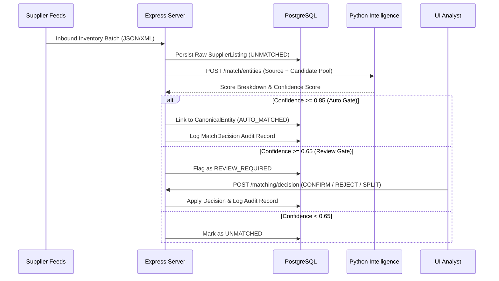

# Technical Architecture — SANGAM

**Where Travel Inventory Comes Together**

---

## 1. System Architecture Overview

Sangam is architected as a modular monorepo comprising three decoupled services communicating over standardized REST contracts:

```
┌─────────────────────────────────────────────────────────────┐
│                      SANGAM CLIENT                          │
│        React 18 + TypeScript + Vite + Tailwind CSS          │
│               Port 5173 (Single Page App)                   │
└──────────────────────────────┬──────────────────────────────┘
                               │ HTTP / JSON (Axios)
                               ▼
┌─────────────────────────────────────────────────────────────┐
│                      SANGAM SERVER                          │
│            Node.js + Express.js + TypeScript                │
│                 Port 4000 (API Gateway)                     │
│        - Auth & Session (JWT + bcryptjs)                    │
│        - Ingest Pipeline & Inventory Management             │
│        - Prisma ORM (Relational Layer)                      │
└──────────────┬───────────────────────────────┬──────────────┘
               │                               │
               │ Prisma Driver                 │ HTTP / REST
               ▼                               ▼
┌──────────────────────────────┐ ┌──────────────────────────────┐
│      POSTGRESQL DATABASE     │ │     SANGAM INTELLIGENCE      │
│   Neon / Docker Compatible   │ │    Python 3.14 + FastAPI     │
│   - JSONB flexible payloads  │ │          Port 8000           │
│   - 10 Relational Models     │ │ - RapidFuzz String Matching  │
│   - Audit Decision Logs      │ │ - Haversine Geo Proximity    │
└──────────────────────────────┘ │ - Multi-Criteria Ranker      │
                                 └──────────────────────────────┘
```

---

## 2. Core Service Boundaries

### 2.1 Frontend Client (`/client`)
- **Framework:** React 18 with Vite and TypeScript strict mode.
- **Styling:** Custom Tailwind CSS configuration adhering to Sangam's Indian-origin enterprise identity (Deep navy `#0B192C`, rich teal `#0D9488`, clean slate `#F8FAFC`).
- **State & Context:** React Router DOM v6, Axios interceptor for JWT authorization, React Context for session management.
- **Visualizations:** Recharts for inventory consolidation curves and supplier distribution.

### 2.2 Express API Backend (`/server`)
- **Framework:** Express.js 4 with TypeScript (`strict: true`).
- **Database Access:** Prisma ORM 5 with connection pooling.
- **Validation:** Zod schemas applied as Express middleware before controllers.
- **Security:** Password hashing via bcryptjs (10 rounds), stateless JWT auth, CORS lockdown.
- **Resilience:** Graceful shutdown on SIGTERM/SIGINT closing DB pools and HTTP listeners cleanly.

### 2.3 Python Intelligence Service (`/intelligence`)
- **Framework:** FastAPI with Uvicorn.
- **Deduplication Engine:** RapidFuzz token set ratio and partial ratio for word-order invariance.
- **Spatial Processing:** Haversine great-circle distance computation for coordinate proximity.
- **Offer Ranking:** Multi-criteria weighted normalization across price spread, supplier fulfillment score, cancellation penalty windows, and value of inclusions.
- **Explainability:** Returns decomposed score components for complete transparency to analysts.

---

## 3. Data Flow & Deduplication Lifecycle



---

## 4. Non-Destructive Storage Pattern

A foundational architectural requirement of Sangam is **zero destructive merging**:
- Supplier listings are never overwritten or deleted when matched.
- The `canonicalEntityId` column in `supplier_listings` establishes a foreign-key relationship without altering the original supplier-specific IDs or descriptions.
- The `rawData` JSONB column stores the full unmodified supplier payload for auditability and replayability.
