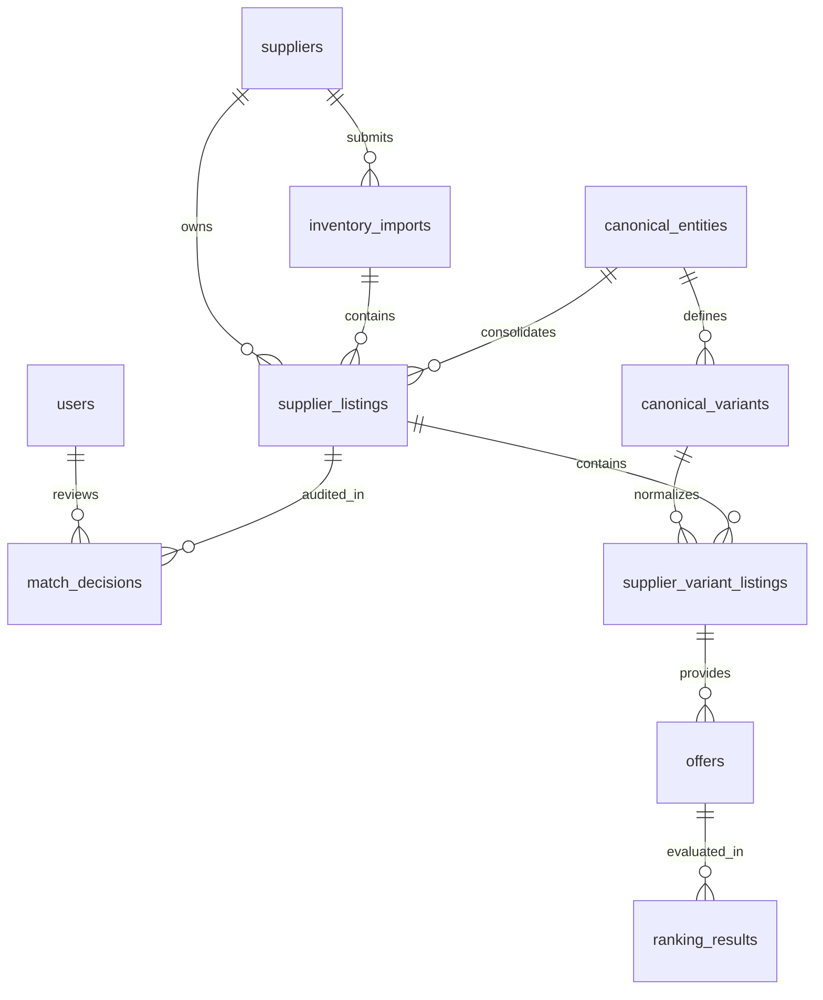

# Database Architecture & Schema Reference — SANGAM

**Database Engine:** PostgreSQL 16+ / Neon Compatible  
**ORM:** Prisma ORM 5.x  
**Primary Key Strategy:** UUID v4  
**Monetary Representation:** `Decimal(10, 2)`

---

## 1. Entity-Relationship Diagram (ERD)

---

## 2. Model Definitions & Data Dictionary

### 2.1 `users`
System operators, inventory analysts, and administrator accounts.
| Column | Type | Constraints | Description |
|---|---|---|---|
| `id` | UUID | PK, default uuid | Unique internal identifier |
| `email` | String | Unique, Indexed | User login email |
| `passwordHash` | String | Not Null | Bcrypt hashed password |
| `name` | String | Not Null | Full display name |
| `role` | Enum | Default `ANALYST` | `ADMIN`, `ANALYST`, `VIEWER` |
| `createdAt` | DateTime | Default `now()` | Registration timestamp |
| `updatedAt` | DateTime | Auto-updated | Modification timestamp |

### 2.2 `suppliers`
Connected external travel inventory providers (bedbanks, activity brokers, DMCs).
| Column | Type | Constraints | Description |
|---|---|---|---|
| `id` | UUID | PK, default uuid | Unique supplier identifier |
| `code` | String | Unique, Indexed | Supplier code (e.g. `SUP-BOOKINGBRIDGE`) |
| `name` | String | Not Null | Business entity name |
| `contactEmail`| String | Nullable | Integration point of contact |
| `status` | Enum | Default `ACTIVE` | `ACTIVE`, `INACTIVE`, `SUSPENDED` |
| `reliabilityScore` | Decimal(5,2) | Default `1.00` | Historical fulfillment reliability (0.0 to 1.0) |
| `apiEndpoint` | String | Nullable | Supplier REST/GraphQL ingest endpoint |
| `metadata` | JSONB | Default `{}` | Flexible connectivity flags, refresh rates |

### 2.3 `inventory_imports`
Tracks batch inventory feeds ingested from suppliers.
| Column | Type | Constraints | Description |
|---|---|---|---|
| `id` | UUID | PK, default uuid | Unique batch identifier |
| `supplierId` | UUID | FK -> `suppliers.id` | Source supplier |
| `importRef` | String | Unique, Indexed | External batch reference |
| `category` | Enum | Not Null | `HOTEL`, `SIGHTSEEING` |
| `status` | Enum | Default `PENDING` | `PENDING`, `PROCESSING`, `COMPLETED`, `FAILED` |
| `totalRecords` | Int | Default `0` | Expected listing count |
| `processedRecords` | Int | Default `0` | Processed listing count |
| `errorLog` | JSONB | Default `[]` | Ingest errors and warnings |

### 2.4 `canonical_entities`
Master de-duplicated product records representing real-world properties or tours.
| Column | Type | Constraints | Description |
|---|---|---|---|
| `id` | UUID | PK, default uuid | Canonical master entity ID |
| `category` | Enum | Not Null, Indexed | `HOTEL`, `SIGHTSEEING` |
| `name` | String | Not Null | Canonical title |
| `standardizedName` | String | Indexed | Cleaned, lowercased, noise-stripped token string |
| `destinationCity` | String | Indexed | Normalized destination city |
| `destinationCountry` | String | Indexed | Normalized destination country |
| `latitude` | Decimal(10,6)| Nullable | Normalized GPS latitude |
| `longitude`| Decimal(10,6)| Nullable | Normalized GPS longitude |
| `starRating` | Decimal(3,1)| Nullable | Star rating (Hotels only) |
| `address` | String | Nullable | Normalized physical address |
| `description` | Text | Nullable | Master synthesized description |
| `attributes` | JSONB | Default `{}` | Facilities, pool, duration, access type |
| `status` | Enum | Default `ACTIVE` | `ACTIVE`, `DRAFT`, `MERGED`, `ARCHIVED` |

### 2.5 `supplier_listings`
Preserves raw supplier listings exactly as supplied.
| Column | Type | Constraints | Description |
|---|---|---|---|
| `id` | UUID | PK, default uuid | Listing record ID |
| `supplierId` | UUID | FK -> `suppliers.id` | Providing supplier |
| `importId` | UUID | FK -> `inventory_imports.id` | Ingest batch |
| `canonicalEntityId` | UUID | FK -> `canonical_entities.id`, Nullable | Linked canonical master (null if unconfirmed) |
| `externalId` | String | Indexed | Supplier's native product ID |
| `category` | Enum | Not Null | `HOTEL`, `SIGHTSEEING` |
| `rawName` | String | Not Null | Unmodified supplier property name |
| `normalizedName` | String | Indexed | Standardized tokens for index scanning |
| `rawAddress` | String | Nullable | Raw address string |
| `city` / `country` | String | Nullable | Raw location fields |
| `rawData` | JSONB | Default `{}` | Full unaltered raw supplier JSON payload |
| `matchStatus` | Enum | Default `UNMATCHED` | `UNMATCHED`, `AUTO_MATCHED`, `MANUALLY_MATCHED`, `REVIEW_REQUIRED`, `REJECTED` |
| `matchConfidence` | Decimal(5,4)| Nullable | Algorithmic match score (0.0000 to 1.0000) |

### 2.6 `canonical_variants`
Normalized room categories (e.g. "Deluxe King") or tour tiers (e.g. "Full Day Safari").

### 2.7 `supplier_variant_listings`
Supplier-specific room categories or ticket tiers linking back to `supplier_listings`.

### 2.8 `offers`
Bookable rates, inventory count, cancellation policies, and inclusions.
| Column | Type | Constraints | Description |
|---|---|---|---|
| `id` | UUID | PK | Unique offer rate ID |
| `supplierVariantListingId` | UUID | FK -> `supplier_variant_listings.id` | Target variant |
| `currency` | String | Default `USD` | ISO 4217 Currency Code |
| `basePrice` / `netPrice` | Decimal(10,2)| Not Null | Financial values |
| `taxAmount` | Decimal(10,2)| Default `0.00` | Mandatory taxes & fees |
| `availabilityCount` | Int | Nullable | Available seats / rooms |
| `cancellationPolicy` | JSONB | Default `{}` | `{ refundable, deadline_hours, penalty }` |
| `mealPlan` | String | Nullable | `Bed & Breakfast`, `All Inclusive`, etc. |
| `transferIncluded` | Boolean | Default `false` | Airport/station transfer flag |
| `inclusions` | JSONB | Default `[]` | List of included perks |

### 2.9 `match_decisions`
Complete audit trail for all algorithmic and human matching decisions.
| Column | Type | Constraints | Description |
|---|---|---|---|
| `id` | UUID | PK | Audit record ID |
| `entityType` | Enum | Not Null | `ENTITY`, `VARIANT` |
| `sourceListingId` | UUID | Indexed | Source supplier record |
| `targetCanonicalId` | UUID | Indexed | Target canonical entity |
| `decision` | Enum | Not Null | `AUTO_ACCEPT`, `MANUAL_CONFIRM`, `MANUAL_REJECT`, `SPLIT` |
| `confidenceScore` | Decimal(5,4)| Not Null | Confidence score |
| `explanation` | JSONB | Default `{}` | Decomposed scoring weights & reasoning |
| `decidedByUserId` | UUID | FK -> `users.id`, Nullable | Analyst who signed off (null if automated) |
| `decidedAt` | DateTime | Default `now()` | Audit timestamp |

### 2.10 `ranking_results`
Calculated multi-criteria offer intelligence and recommendation rankings.

---

## 3. Indexing Strategy

1. **Compound Unique Index:** `[supplierId, externalId]` on `supplier_listings` prevents duplicate ingestion of the same external ID from a single supplier.
2. **Category & Status Filtering:** B-tree indexes on `category`, `matchStatus`, `status` ensure fast query response times across millions of records.
3. **Location Search:** Indexes on `destinationCity` and `destinationCountry` enable sub-millisecond geographic lookups.
