# Database Design & Schema Reference — SANGAM

**Product Name:** Sangam  
**Tagline:** Where Travel Inventory Comes Together  
**Document Version:** 1.1.0  
**Database Engine:** PostgreSQL 16+ (Neon-compatible)  
**ORM:** Prisma ORM 5.22.0  
**Last Updated:** November 2026  
**Related Documents:** [ARCHITECTURE.md](ARCHITECTURE.md) • [PRD.md](PRD.md) • [DATA_DICTIONARY.md](DATA_DICTIONARY.md)

---

## 1. Database Philosophy & The 4-Tier Inventory Hierarchy

The foundational architectural principle of Sangam is **non-destructive consolidation**. In the travel domain, conflating a real-world hotel with a specific bedbank's rate or room description causes irreversible data loss and booking failures.

To solve this, Sangam enforces a strict **4-Tier Inventory Hierarchy**:

```
Tier 1: Canonical Travel Product (CanonicalEntity)
        └── Real-world physical property or attraction (e.g., The Oberoi Grand Kolkata)
              │
Tier 2: Supplier Listings (SupplierListing)
        ├── Supplier A's view (BB-HTL-77401: "The Oberoi Grand Kolkata")
        ├── Supplier B's view (GBB-108422: "The Oberoi Grand, Kolkata")
        └── Supplier C's view (DC-IND-00439: "Oberoi Grand Hotel")
              │
Tier 3: Product Variants (CanonicalVariant & SupplierVariantListing)
        ├── Canonical Variant: "Deluxe King Heritage Room" (Standardized code: DLX-KNG)
        └── Supplier Variants: Supplier A ("Deluxe King"), Supplier B ("1 King Bed Deluxe")
              │
Tier 4: Bookable Offers (Offer & RankingResult)
        ├── Supplier A: $130.00 / Bed & Breakfast / 48h Free Cancellation / Reliability 94%
        └── Supplier B: $122.00 / Room Only / 24h Free Cancellation + Transfer / Reliability 88%
```

### Why This Separation is Mandatory:
1. **Preservation of Raw Supplier Data:** If an OTA booker completes a reservation, the system must dispatch the exact `externalId` and booking parameters required by Supplier B's API. Overwriting Supplier B's record with Supplier A's name causes booking rejection.
2. **Dynamic Supplier Re-linking:** If an analyst determines two listings were falsely merged, unlinking them requires simply updating `supplier_listings.canonicalEntityId = null` without needing to re-ingest raw data.
3. **Many-to-One Consolidation:** Multiple supplier listings link to one canonical master entity, preserving supplier pricing competition on identical physical inventory.

---

## 2. Complete Entity-Relationship Diagram (ERD)

```mermaid
erDiagram
    users ||--o{ match_decisions : "audits"
    suppliers ||--o{ inventory_imports : "submits"
    suppliers ||--o{ supplier_listings : "supplies"
    inventory_imports ||--o{ supplier_listings : "contains"
    canonical_entities ||--o{ supplier_listings : "consolidates"
    canonical_entities ||--o{ canonical_variants : "categorizes"
    canonical_variants ||--o{ supplier_variant_listings : "normalizes"
    supplier_listings ||--o{ supplier_variant_listings : "breaks_down"
    supplier_variant_listings ||--o{ offers : "prices"
    offers ||--o{ ranking_results : "evaluated_as"

    users {
        string id PK
        string email UK
        string passwordHash
        string name
        enum role
        datetime createdAt
        datetime updatedAt
    }

    suppliers {
        string id PK
        string code UK
        string name
        string contactEmail
        enum status
        decimal reliabilityScore
        string apiEndpoint
        json metadata
        datetime createdAt
        datetime updatedAt
    }

    inventory_imports {
        string id PK
        string supplierId FK
        string importRef UK
        enum category
        enum status
        int totalRecords
        int processedRecords
        json errorLog
        datetime startedAt
        datetime completedAt
    }

    canonical_entities {
        string id PK
        enum category
        string name
        string standardizedName
        string destinationCity
        string destinationCountry
        decimal latitude
        decimal longitude
        decimal starRating
        string address
        text description
        json attributes
        enum status
        datetime createdAt
        datetime updatedAt
    }

    supplier_listings {
        string id PK
        string supplierId FK
        string importId FK
        string canonicalEntityId FK
        string externalId
        enum category
        string rawName
        string normalizedName
        string rawAddress
        string city
        string country
        decimal latitude
        decimal longitude
        decimal starRating
        text rawDescription
        json rawData
        enum matchStatus
        decimal matchConfidence
        datetime createdAt
        datetime updatedAt
    }

    canonical_variants {
        string id PK
        string canonicalEntityId FK
        enum category
        string name
        string standardCode
        text description
        json attributes
        datetime createdAt
        datetime updatedAt
    }

    supplier_variant_listings {
        string id PK
        string supplierListingId FK
        string canonicalVariantId FK
        string externalVariantId
        string rawName
        string normalizedName
        text rawDescription
        json rawData
        enum matchStatus
        decimal matchConfidence
        datetime createdAt
        datetime updatedAt
    }

    offers {
        string id PK
        string supplierVariantListingId FK
        string currency
        decimal basePrice
        decimal netPrice
        decimal taxAmount
        int availabilityCount
        datetime checkInDate
        datetime checkOutDate
        datetime validFrom
        datetime validTo
        json cancellationPolicy
        string mealPlan
        boolean transferIncluded
        json inclusions
        text bookingConditions
        datetime retrievedAt
        datetime expiresAt
    }

    match_decisions {
        string id PK
        enum entityType
        string sourceListingId
        string targetCanonicalId
        enum decision
        decimal confidenceScore
        json explanation
        string decidedByUserId FK
        datetime decidedAt
    }

    ranking_results {
        string id PK
        json queryContext
        string offerId FK
        int rankPosition
        decimal overallScore
        decimal priceScore
        decimal reliabilityScore
        decimal cancellationScore
        json scoreBreakdown
        datetime computedAt
    }
```



---

## 3. Enumerations Reference

The schema defines 8 dedicated Postgres ENUM types:

| Enum Name | Allowed Values | Usage |
|---|---|---|
| `UserRole` | `ADMIN`, `ANALYST`, `VIEWER` | RBAC authorization on user accounts. |
| `SupplierStatus` | `ACTIVE`, `INACTIVE`, `SUSPENDED` | Lifecycle status of supplier feed connection. |
| `ImportStatus` | `PENDING`, `PROCESSING`, `COMPLETED`, `FAILED` | Ingest batch processing lifecycle. |
| `InventoryCategory` | `HOTEL`, `SIGHTSEEING` | Primary vertical discriminator across products and feeds. |
| `MatchStatus` | `UNMATCHED`, `AUTO_MATCHED`, `MANUALLY_MATCHED`, `REVIEW_REQUIRED`, `REJECTED` | Deduplication lifecycle state of supplier listings. |
| `CanonicalStatus` | `ACTIVE`, `DRAFT`, `MERGED`, `ARCHIVED` | Lifecycle of master de-duplicated entities. |
| `DecisionType` | `AUTO_ACCEPT`, `MANUAL_CONFIRM`, `MANUAL_REJECT`, `SPLIT` | Specific decision recorded in match audit trail. |
| `DecisionEntityType`| `ENTITY`, `VARIANT` | Level of inventory hierarchy targeted by a match decision. |

---

## 4. Detailed Model Specifications

### 4.1 Model: `User` (`users`)
Represents internal operators and analysts accessing the dashboard.
- **Table Name:** `users`
- **Primary Key:** `id` (`UUID` v4)
- **Relationships:** One-to-many with `MatchDecision` (`matchDecisions`).

| Column | Prisma Type | DB Type | Constraints | Description |
|---|---|---|---|---|
| `id` | `String` | `TEXT` | `@id @default(uuid())` | Unique user identifier |
| `email` | `String` | `TEXT` | `@unique` | Login email address |
| `passwordHash` | `String` | `TEXT` | `NOT NULL` | Bcrypt password hash (10 rounds) |
| `name` | `String` | `TEXT` | `NOT NULL` | Full display name |
| `role` | `UserRole` | `ENUM` | `@default(ANALYST)` | Security role |
| `createdAt` | `DateTime` | `TIMESTAMP(3)` | `@default(now())` | Record creation timestamp |
| `updatedAt` | `DateTime` | `TIMESTAMP(3)` | `@updatedAt` | Automatic update timestamp |

---

### 4.2 Model: `Supplier` (`suppliers`)
Represents an external travel supplier, bedbank, or tour aggregator.
- **Table Name:** `suppliers`
- **Primary Key:** `id` (`UUID` v4)
- **Indexes:** `[status]`, `[code]`
- **Relationships:** One-to-many with `InventoryImport` (`imports`), one-to-many with `SupplierListing` (`listings`).

| Column | Prisma Type | DB Type | Constraints | Description |
|---|---|---|---|---|
| `id` | `String` | `TEXT` | `@id @default(uuid())` | Unique supplier identifier |
| `code` | `String` | `TEXT` | `@unique` | Identifier code (e.g. `SUP-BOOKINGBRIDGE`) |
| `name` | `String` | `TEXT` | `NOT NULL` | Supplier entity name |
| `contactEmail` | `String?` | `TEXT` | `NULLABLE` | Point of contact email |
| `status` | `SupplierStatus` | `ENUM` | `@default(ACTIVE)` | Feed operational status |
| `reliabilityScore` | `Decimal` | `DECIMAL(5,2)` | `@default(1.00)` | Historical reliability score ($0.0 \dots 1.0$) |
| `apiEndpoint` | `String?` | `TEXT` | `NULLABLE` | Base URL for supplier API |
| `metadata` | `Json` | `JSONB` | `@default("{}")` | Connectivity options, refresh interval |
| `createdAt` | `DateTime` | `TIMESTAMP(3)` | `@default(now())` | Registration timestamp |
| `updatedAt` | `DateTime` | `TIMESTAMP(3)` | `@updatedAt` | Automatic update timestamp |

---

### 4.3 Model: `InventoryImport` (`inventory_imports`)
Tracks batch ingestion jobs submitted by suppliers.
- **Table Name:** `inventory_imports`
- **Primary Key:** `id` (`UUID` v4)
- **Foreign Keys:** `supplierId` $\to$ `Supplier.id` (`ON DELETE Cascade`)
- **Indexes:** `[supplierId]`, `[status]`, `[category]`
- **Relationships:** Many-to-one with `Supplier`, one-to-many with `SupplierListing` (`listings`).

| Column | Prisma Type | DB Type | Constraints | Description |
|---|---|---|---|---|
| `id` | `String` | `TEXT` | `@id @default(uuid())` | Unique batch identifier |
| `supplierId` | `String` | `TEXT` | `NOT NULL` | Foreign key referencing `suppliers.id` |
| `importRef` | `String` | `TEXT` | `@unique` | Human-readable batch reference code |
| `category` | `InventoryCategory` | `ENUM` | `NOT NULL` | Vertical discriminator (`HOTEL`/`SIGHTSEEING`) |
| `status` | `ImportStatus` | `ENUM` | `@default(PENDING)` | Current processing status |
| `totalRecords` | `Int` | `INTEGER` | `@default(0)` | Total records declared in payload |
| `processedRecords` | `Int` | `INTEGER` | `@default(0)` | Successfully processed records count |
| `errorLog` | `Json` | `JSONB` | `@default("[]")` | Array of error messages or validation flags |
| `startedAt` | `DateTime` | `TIMESTAMP(3)` | `@default(now())` | Batch start timestamp |
| `completedAt` | `DateTime?` | `TIMESTAMP(3)` | `NULLABLE` | Batch completion timestamp |

---

### 4.4 Model: `CanonicalEntity` (`canonical_entities`)
The de-duplicated, consolidated master record representing a single physical property or experience.
- **Table Name:** `canonical_entities`
- **Primary Key:** `id` (`UUID` v4)
- **Indexes:** `[category]`, `[destinationCity]`, `[destinationCountry]`, `[standardizedName]`
- **Relationships:** One-to-many with `SupplierListing` (`supplierListings`), one-to-many with `CanonicalVariant` (`variants`).

| Column | Prisma Type | DB Type | Constraints | Description |
|---|---|---|---|---|
| `id` | `String` | `TEXT` | `@id @default(uuid())` | Master canonical identifier |
| `category` | `InventoryCategory` | `ENUM` | `NOT NULL` | Vertical (`HOTEL` or `SIGHTSEEING`) |
| `name` | `String` | `TEXT` | `NOT NULL` | Canonical master display title |
| `standardizedName` | `String` | `TEXT` | `NOT NULL` | Tokenized, lowercased name for matching index |
| `destinationCity` | `String` | `TEXT` | `NOT NULL` | Standardized destination city |
| `destinationCountry` | `String` | `TEXT` | `NOT NULL` | Standardized country |
| `latitude` | `Decimal?` | `DECIMAL(10,6)` | `NULLABLE` | Verified GPS latitude coordinates |
| `longitude` | `Decimal?` | `DECIMAL(10,6)` | `NULLABLE` | Verified GPS longitude coordinates |
| `starRating` | `Decimal?` | `DECIMAL(3,1)` | `NULLABLE` | Official star rating (Hotels only) |
| `address` | `String?` | `TEXT` | `NULLABLE` | Normalized master physical address |
| `description` | `String?` | `TEXT` | `NULLABLE` | Consolidated master description text |
| `attributes` | `Json` | `JSONB` | `@default("{}")` | Master amenities, duration, access types |
| `status` | `CanonicalStatus` | `ENUM` | `@default(ACTIVE)` | Lifecycle state of canonical entity |
| `createdAt` | `DateTime` | `TIMESTAMP(3)` | `@default(now())` | Entity creation timestamp |
| `updatedAt` | `DateTime` | `TIMESTAMP(3)` | `@updatedAt` | Automatic update timestamp |

---

### 4.5 Model: `SupplierListing` (`supplier_listings`)
Preserves the exact supplier inventory record as supplied in external feeds.
- **Table Name:** `supplier_listings`
- **Primary Key:** `id` (`UUID` v4)
- **Unique Constraints:** `@@unique([supplierId, externalId])` ensures idempotency per supplier.
- **Foreign Keys:**
  - `supplierId` $\to$ `Supplier.id` (`ON DELETE Cascade`)
  - `importId` $\to$ `InventoryImport.id` (`ON DELETE SetNull`, nullable)
  - `canonicalEntityId` $\to$ `CanonicalEntity.id` (`ON DELETE SetNull`, nullable for unconfirmed listings)
- **Indexes:** `[supplierId]`, `[canonicalEntityId]`, `[category]`, `[matchStatus]`, `[normalizedName]`, `[city]`
- **Relationships:** Many-to-one with `Supplier`, `InventoryImport`, `CanonicalEntity`; one-to-many with `SupplierVariantListing`.

| Column | Prisma Type | DB Type | Constraints | Description |
|---|---|---|---|---|
| `id` | `String` | `TEXT` | `@id @default(uuid())` | Inbound listing identifier |
| `supplierId` | `String` | `TEXT` | `NOT NULL` | Source supplier ID |
| `importId` | `String?` | `TEXT` | `NULLABLE` | Ingestion batch reference |
| `canonicalEntityId` | `String?` | `TEXT` | `NULLABLE` | Linked canonical entity (null if unmatched) |
| `externalId` | `String` | `TEXT` | `NOT NULL` | Supplier's native product identifier |
| `category` | `InventoryCategory` | `ENUM` | `NOT NULL` | Vertical discriminator |
| `rawName` | `String` | `TEXT` | `NOT NULL` | Unmodified property name from supplier |
| `normalizedName` | `String` | `TEXT` | `NOT NULL` | Cleaned token string for candidate lookup |
| `rawAddress` | `String?` | `TEXT` | `NULLABLE` | Supplier's raw address string |
| `city` / `country` | `String?` | `TEXT` | `NULLABLE` | Supplier's raw city and country |
| `latitude` / `longitude` | `Decimal?` | `DECIMAL(10,6)` | `NULLABLE` | GPS coordinates provided by supplier |
| `starRating` | `Decimal?` | `DECIMAL(3,1)` | `NULLABLE` | Star rating declared by supplier |
| `rawDescription` | `String?` | `TEXT` | `NULLABLE` | Raw promotional text |
| `rawData` | `Json` | `JSONB` | `@default("{}")` | Full, unaltered raw JSON payload |
| `matchStatus` | `MatchStatus` | `ENUM` | `@default(UNMATCHED)` | Current deduplication lifecycle status |
| `matchConfidence` | `Decimal?` | `DECIMAL(5,4)` | `NULLABLE` | Computed matching score ($0.0000 \dots 1.0000$) |
| `createdAt` | `DateTime` | `TIMESTAMP(3)` | `@default(now())` | Ingestion timestamp |
| `updatedAt` | `DateTime` | `TIMESTAMP(3)` | `@updatedAt` | Automatic update timestamp |

---

### 4.6 Model: `CanonicalVariant` (`canonical_variants`)
Represents a normalized room type (e.g., "Deluxe King Courtyard") or tour tier.
- **Table Name:** `canonical_variants`
- **Primary Key:** `id` (`UUID` v4)
- **Foreign Keys:** `canonicalEntityId` $\to$ `CanonicalEntity.id` (`ON DELETE Cascade`)
- **Indexes:** `[canonicalEntityId]`, `[category]`, `[name]`
- **Relationships:** Many-to-one with `CanonicalEntity`, one-to-many with `SupplierVariantListing`.

---

### 4.7 Model: `SupplierVariantListing` (`supplier_variant_listings`)
Supplier-specific room type or ticket option.
- **Table Name:** `supplier_variant_listings`
- **Primary Key:** `id` (`UUID` v4)
- **Unique Constraints:** `@@unique([supplierListingId, externalVariantId])`
- **Foreign Keys:**
  - `supplierListingId` $\to$ `SupplierListing.id` (`ON DELETE Cascade`)
  - `canonicalVariantId` $\to$ `CanonicalVariant.id` (`ON DELETE SetNull`, nullable)
- **Indexes:** `[supplierListingId]`, `[canonicalVariantId]`, `[matchStatus]`
- **Relationships:** Many-to-one with `SupplierListing`, `CanonicalVariant`; one-to-many with `Offer`.

---

### 4.8 Model: `Offer` (`offers`)
Real-time or cached commercial rates, cancellation terms, and inclusions.
- **Table Name:** `offers`
- **Primary Key:** `id` (`UUID` v4)
- **Foreign Keys:** `supplierVariantListingId` $\to$ `SupplierVariantListing.id` (`ON DELETE Cascade`)
- **Indexes:** `[supplierVariantListingId]`, `[netPrice]`, `[currency]`
- **Relationships:** Many-to-one with `SupplierVariantListing`, one-to-many with `RankingResult`.

| Column | Prisma Type | DB Type | Constraints | Description |
|---|---|---|---|---|
| `id` | `String` | `TEXT` | `@id @default(uuid())` | Unique offer rate ID |
| `supplierVariantListingId` | `String` | `TEXT` | `NOT NULL` | Linked supplier variant |
| `currency` | `String` | `TEXT` | `@default("USD")` | ISO 4217 Currency code |
| `basePrice` | `Decimal` | `DECIMAL(10,2)` | `NOT NULL` | Gross retail/public price |
| `netPrice` | `Decimal` | `DECIMAL(10,2)` | `NOT NULL` | Wholesaler B2B net buy rate |
| `taxAmount` | `Decimal` | `DECIMAL(10,2)` | `@default(0.00)` | Mandatory local taxes & resort fees |
| `availabilityCount` | `Int?` | `INTEGER` | `@default(1)` | Available allotment units |
| `checkInDate` / `checkOutDate` | `DateTime?` | `TIMESTAMP(3)` | `NULLABLE` | Stay dates (Hotels) |
| `validFrom` / `validTo` | `DateTime?` | `TIMESTAMP(3)` | `NULLABLE` | Validity window (Sightseeing) |
| `cancellationPolicy` | `Json` | `JSONB` | `@default("{}")` | `{ refundable, deadline_hours, penalty }` |
| `mealPlan` | `String?` | `TEXT` | `NULLABLE` | e.g. "Bed & Breakfast", "Room Only" |
| `transferIncluded` | `Boolean` | `BOOLEAN` | `@default(false)` | Flag indicating airport/station transfers |
| `inclusions` | `Json` | `JSONB` | `@default("[]")` | Array of included perks/tickets |
| `bookingConditions` | `String?` | `TEXT` | `NULLABLE` | Special contractual constraints |
| `retrievedAt` | `DateTime` | `TIMESTAMP(3)` | `@default(now())` | Price quote timestamp |
| `expiresAt` | `DateTime?` | `TIMESTAMP(3)` | `NULLABLE` | Rate expiry timestamp |

---

### 4.9 Model: `MatchDecision` (`match_decisions`)
Immutable audit trail recording every automated and human deduplication decision.
- **Table Name:** `match_decisions`
- **Primary Key:** `id` (`UUID` v4)
- **Foreign Keys:** `decidedByUserId` $\to$ `User.id` (`ON DELETE SetNull`, nullable for automated jobs)
- **Indexes:** `[sourceListingId]`, `[targetCanonicalId]`, `[decision]`, `[decidedAt]`
- **Relationships:** Many-to-one with `User` (`decidedByUser`).

| Column | Prisma Type | DB Type | Constraints | Description |
|---|---|---|---|---|
| `id` | `String` | `TEXT` | `@id @default(uuid())` | Unique decision audit ID |
| `entityType` | `DecisionEntityType` | `ENUM` | `NOT NULL` | Target level (`ENTITY` or `VARIANT`) |
| `sourceListingId` | `String` | `TEXT` | `NOT NULL` | Source supplier listing ID |
| `targetCanonicalId` | `String` | `TEXT` | `NOT NULL` | Target canonical entity ID |
| `decision` | `DecisionType` | `ENUM` | `NOT NULL` | Decision taken (`AUTO_ACCEPT`, `MANUAL_CONFIRM`, etc.) |
| `confidenceScore` | `Decimal` | `DECIMAL(5,4)` | `NOT NULL` | Score at time of decision ($0.0 \dots 1.0$) |
| `explanation` | `Json` | `JSONB` | `@default("{}")` | Decomposed metric breakdown and notes |
| `decidedByUserId` | `String?` | `TEXT` | `NULLABLE` | Analyst user ID (null if automated) |
| `decidedAt` | `DateTime` | `TIMESTAMP(3)` | `@default(now())` | Exact audit timestamp |

---

### 4.10 Model: `RankingResult` (`ranking_results`)
Output of the multi-criteria offer intelligence algorithm.
- **Table Name:** `ranking_results`
- **Primary Key:** `id` (`UUID` v4)
- **Foreign Keys:** `offerId` $\to$ `Offer.id` (`ON DELETE Cascade`)
- **Indexes:** `[offerId]`, `[rankPosition]`, `[overallScore]`
- **Relationships:** Many-to-one with `Offer`.

| Column | Prisma Type | DB Type | Constraints | Description |
|---|---|---|---|---|
| `id` | `String` | `TEXT` | `@id @default(uuid())` | Ranking computation ID |
| `queryContext` | `Json` | `JSONB` | `@default("{}")` | Search context (dates, canonical ID) |
| `offerId` | `String` | `TEXT` | `NOT NULL` | Evaluated offer ID |
| `rankPosition` | `Int` | `INTEGER` | `NOT NULL` | Output rank ($1 = \text{best}$) |
| `overallScore` | `Decimal` | `DECIMAL(5,4)` | `NOT NULL` | Weighted composite score ($0.0 \dots 1.0$) |
| `priceScore` | `Decimal` | `DECIMAL(5,4)` | `NOT NULL` | Price competitiveness score ($0.2 \dots 1.0$) |
| `reliabilityScore` | `Decimal` | `DECIMAL(5,4)` | `NOT NULL` | Supplier historical fulfillment score |
| `cancellationScore` | `Decimal` | `DECIMAL(5,4)` | `NOT NULL` | Refundability and deadline score |
| `scoreBreakdown` | `Json` | `JSONB` | `@default("{}")` | Human-readable justification breakdown |
| `computedAt` | `DateTime` | `TIMESTAMP(3)` | `@default(now())` | Calculation timestamp |

---

## 5. Related Documentation Links

- [Product Requirements Document](PRD.md)
- [System Architecture](ARCHITECTURE.md)
- [API Reference](API.md)
- [Data Dictionary](DATA_DICTIONARY.md)
