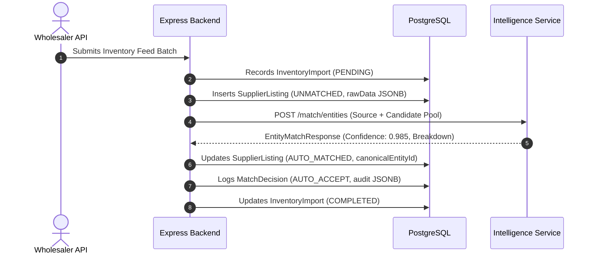
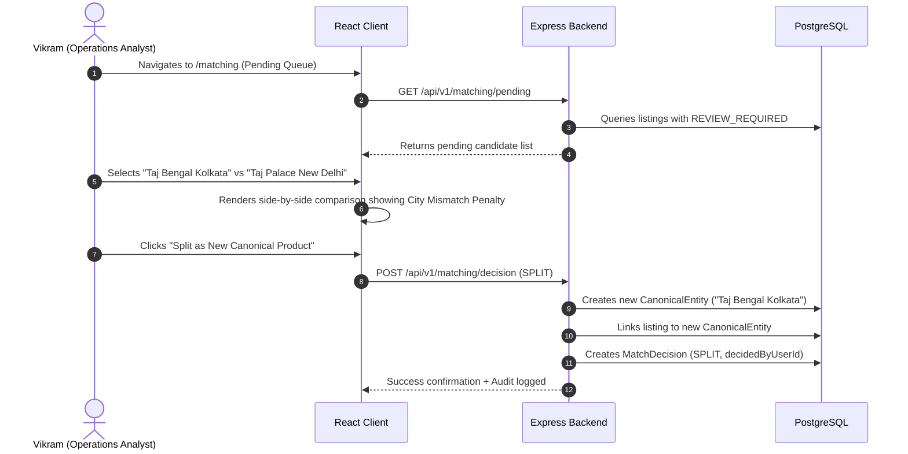

# Product Requirements Document (PRD) — SANGAM

**Product Name:** Sangam  
**Tagline:** Where Travel Inventory Comes Together  
**Document Version:** 1.1.0  
**Status:** Implemented (Hackathon MVP) / Active Expansion (Commercial SaaS)  
**Last Updated:** November 2026  
**Target Audience:** Product Managers, Software Architects, Full-Stack Engineers, Hackathon Judges, Investors  

---

## 1. Product Overview & Vision

Sangam is a specialized B2B TravelTech Software-as-a-Service (SaaS) platform engineered to solve the chronic fragmentation, duplication, and opacity of travel inventory aggregated from disparate suppliers.

In the global travel distribution ecosystem, Online Travel Agencies (OTAs), Bedbanks, Destination Management Companies (DMCs), and Corporate Travel Management Companies (TMCs) consume inventory feeds from dozens of third-party wholesalers (e.g., Hotelbeds, WebBeds, Expedia Partner Solutions, local tour operators). Because no universal Global Trade Item Number (GTIN) exists for travel inventory:
- The exact same hotel property is published under divergent naming structures, non-standard addresses, and varying geographical coordinate accuracy.
- Equivalent room categories (e.g., "Deluxe King Courtyard" vs. "1 King Bed Deluxe") are obscured by supplier-specific taxonomy.
- Identical tours and experiences (e.g., "Victoria Memorial Guided Walk" vs. "Victoria Memorial Entry & Tour") are fragmented across aggregators with conflicting inclusion packages, cancellation terms, and markup schedules.

**Sangam's Vision:** To establish the single source of truth for multi-supplier travel inventory. Sangam ingests raw supplier feeds, deterministically cleanses and normalizes metadata, detects duplicates using multi-signal spatial and fuzzy token matching, preserves all raw supplier attributes non-destructively, and ranks competing offers to maximize profit margins and booking reliability.

---

## 2. Problem Statement & Market Context

### 2.1 The Multi-Supplier Inventory Dilemma
1. **Catalog Pollution & Customer Confusion:** Aggregators displaying multiple listings for the same hotel create decision fatigue and erode consumer trust.
2. **Margin Erosion:** Without automated cross-supplier matching, travel distributors cannot dynamically route bookings to the lowest net-rate supplier for an identical room.
3. **Destructive Merging Risk:** Naive deduplication approaches overwrite supplier-specific codes, descriptions, and booking conditions. When an OTA needs to book via Supplier B, critical booking payload constraints are missing.
4. **Cancellation & Operational Exposure:** Wholesalers frequently offer lower headline rates bundled with punitive non-refundable cancellation terms or poor fulfillment reliability scores. Comparing price alone exposes distributors to customer dispute liabilities.

### 2.2 Market Opportunity
The global travel wholesale and bedbank market processes over $60B annually. Travel distributors spend millions on custom internal data engineering teams attempting to reconcile feeds via brittle SQL scripts and manual Excel comparisons. Sangam provides a multi-vertical, plug-and-play intelligence layer that reduces catalog deduplication time from weeks to seconds while delivering explainable confidence scoring.

---

## 3. Target Customers & User Personas

### 3.1 Target Customer Segments
- **Online Travel Agencies (OTAs):** Mid-market and enterprise OTAs seeking automated deduplication of global bedbank feeds.
- **B2B Bedbanks & Wholesalers:** Wholesalers seeking to audit their catalog overlap and pricing competitiveness relative to rival feeds.
- **Corporate Travel Management Companies (TMCs):** Corporate platforms requiring policy-compliant hotel rates with verified flexible cancellation policies.
- **Destination Management Companies (DMCs):** Inbound operators consolidating local tour and experience inventory.

### 3.2 User Personas

| Persona | Role | Primary Goals | Key Pain Points | Sangam Workflow |
|---|---|---|---|---|
| **Vikram Mehta** | *Inventory Operations Analyst* | Verify borderline duplicate candidates; resolve identity collisions; maintain clean catalog. | Overwhelmed by thousands of unconfirmed inventory records; risk of falsely merging distinct hotels. | Uses **Match Review** queue with side-by-side token breakdown to confirm, reject, or split listings. |
| **Aditi Sharma** | *Commercial Contracting Lead* | Compare supplier net rates across identical room categories; identify uncompetitive suppliers. | Inability to evaluate supplier rate disparities for equivalent cancellation and meal inclusions. | Reviews **Offer Intelligence Matrix** to track supplier rate dispersion and reliability metrics. |
| **Rahul Verma** | *Engineering Lead / Architect* | Integrate supplier feeds via REST APIs; ensure zero data loss and strict audit compliance. | Flaky wholesale XML/JSON feeds; brittle schema migrations; lack of explainability in AI black-boxes. | Interacts with `/api/v1` endpoints; relies on audit trails in `match_decisions` and JSONB persistence. |

---

## 4. Core Product Principles

1. **Non-Destructive Normalization:** Supplier listings must never be destructively overwritten or pruned. Every supplier-specific external ID, raw name, raw address, raw description, and native JSON payload is immutably preserved in `supplier_listings.rawData`.
2. **Explicit Separation of Product vs. Offer:** A real-world physical property or attraction is a `CanonicalEntity`. Its physical room category or tour option is a `CanonicalVariant`. The bookable, time-bound commercial price with cancellation policy from a specific supplier is an `Offer`. These three layers must never be collapsed into a single table.
3. **Explainable Determinism over Black Boxes:** Matching algorithms must provide transparent, metric-level explanations for why two listings are merged or flagged for review.
4. **Human-in-the-Loop Governance:** Autonomous auto-matching is reserved for high-confidence scores ($\ge 0.85$). Ambiguous candidates ($0.65 \le \text{score} < 0.85$) are quarantined in an analyst review queue.

---

## 5. Scope Matrix: Implementation Status

| Feature / Capability | Status | Implementation Details in Codebase |
|---|---|---|
| **Hotel Property Deduplication** | **Implemented** | RapidFuzz token matching, Haversine geo-distance, star rating delta in `intelligence/app/matching/engine.py`. |
| **Sightseeing Attraction Matching** | **Implemented** | Noise-stripped tokens, location radius, and access tier normalization in `intelligence/app/matching/engine.py`. |
| **Room / Variant Matching** | **Implemented** | `fuzz.token_sort_ratio` across room/ticket names in `intelligence/app/matching/engine.py`. |
| **Multi-Criteria Offer Ranking** | **Implemented** | Evaluates price spread, supplier reliability, cancellation flexibility, and inclusions in `intelligence/app/ranking/engine.py`. |
| **Human-in-the-Loop Review UI** | **Implemented** | Side-by-side comparison with Confirm, Reject, and Split actions in `client/src/pages/MatchReviewPage.tsx`. |
| **Non-Destructive Relational Schema** | **Implemented** | 10 PostgreSQL models managed via Prisma ORM in `server/prisma/schema.prisma`. |
| **JWT Authentication & RBAC** | **Implemented** | Bcrypt password hashing, JWT bearer tokens, role checks (`ADMIN`, `ANALYST`, `VIEWER`) in `server/src/modules/auth/`. |
| **Supplier Directory & API Ingest** | **Implemented** | Supplier registration, reliability scoring, batch import tracking in `server/src/modules/suppliers/` & `imports/`. |
| **Offer Comparison Matrix UI** | **Implemented** | Filterable side-by-side multi-supplier comparison matrix in `client/src/pages/OfferComparisonPage.tsx`. |
| **Real-time Wholesaler Streaming** | *Planned (Phase 2)* | Message broker (Redis Streams / BullMQ) for continuous XML/JSON wholesale feed ingestion. |
| **Dense Semantic Vector Embeddings** | *Planned (Phase 2)* | Hybrid retrieval combining Sentence-Transformers dense embeddings with RapidFuzz lexical matching. |
| **Live Currency FX Normalization** | *Planned (Phase 2)* | Dynamic foreign exchange rate integration (currently normalized to USD across datasets). |
| **Automated Booking Fulfillment Router** | *Future Enhancement* | Autonomous routing of booking reservations back to supplier reservation APIs. |

---

## 6. Functional Requirements

### 6.1 Hotel Vertical
- **FR-HTL-01:** System must ingest hotel listings with raw property name, address, latitude, longitude, star rating, descriptions, and supplier metadata.
- **FR-HTL-02:** System must strip hotel noise tokens (`hotel`, `resort`, `spa`, `suites`, `inn`, `palace`, `ltd`, `pvt`) while preserving distinctive brand names (e.g., "The Oberoi Grand Kolkata" $\to$ "oberoi grand kolkata").
- **FR-HTL-03:** System must compute geographic distance using the Haversine formula and enforce heavy penalties ($0.3\times$ multiplier) if city names conflict.
- **FR-HTL-04:** System must group supplier room variations under canonical room variants (e.g., "Deluxe King Heritage Room" and "Deluxe Room, 1 King Bed" mapped to canonical variant `DLX-KNG-COURTYARD`).
- **FR-HTL-05:** System must compare room offers across net price, meal plans (`Room Only`, `Bed & Breakfast`, `All Inclusive`), cancellation deadlines, and supplier reliability.

### 6.2 Sightseeing & Activities Vertical
- **FR-ACT-01:** System must ingest tour, attraction, and experience listings across regional suppliers and DMCs.
- **FR-ACT-02:** System must normalize sightseeing noise tokens (`tour`, `tours`, `ticket`, `tickets`, `admission`, `entry`, `experience`, `guided`, `visit`, `cruise`).
- **FR-ACT-03:** System must distinguish between identical geographical locations with different experience tiers (e.g., "Victoria Memorial General Admission" vs. "Victoria Memorial Guided Heritage Tour with Hotel Pickup").
- **FR-ACT-04:** System must extract and compare duration (hours/days), transfer inclusions, audio guides, forest permits, and meal inclusions.

### 6.3 Ingestion & Data Management
- **FR-ING-01:** System must track every ingest job in `inventory_imports` with `importRef`, `status`, `totalRecords`, and `processedRecords`.
- **FR-ING-02:** Inbound records must be uniquely constrained on `[supplierId, externalId]` to prevent internal duplication.
- **FR-ING-03:** System must preserve unmodified supplier payloads in JSONB columns (`rawData`, `metadata`, `attributes`).

### 6.4 Matching & Governance
- **FR-MAT-01:** High-confidence matches ($\text{overallScore} \ge 0.85$) must automatically link to the canonical entity and mark status as `AUTO_MATCHED`.
- **FR-MAT-02:** Borderline matches ($0.65 \le \text{overallScore} < 0.85$) must be quarantined with status `REVIEW_REQUIRED`.
- **FR-MAT-03:** Low-confidence candidates ($\text{overallScore} < 0.65$) must remain `UNMATCHED`.
- **FR-MAT-04:** Analysts must be able to:
  - **Confirm Match (`MANUAL_CONFIRM`):** Links source listing to selected canonical entity.
  - **Reject Match (`MANUAL_REJECT`):** Marks source listing as `REJECTED`.
  - **Split Product (`SPLIT`):** Creates an entirely new canonical entity from the source listing and links it.
- **FR-MAT-05:** Every matching decision must create an immutable audit record in `match_decisions` containing reviewer ID, decision type, confidence score, and decomposed scoring breakdown.

### 6.5 Offer Ranking
- **FR-RNK-01:** System must evaluate multi-supplier offers using configurable weights for Price ($40\%$), Supplier Reliability ($25\%$), Cancellation Flexibility ($20\%$), and Inclusions Value ($15\%$).
- **FR-RNK-02:** System must output rank positions ($1, 2, \dots, n$), overall score ($0.0 \dots 1.0$), and human-readable justification for the recommended rank.

---

## 7. Non-Functional Requirements

- **NFR-PERF-01 (API Latency):** Read queries for inventory and entity lists must respond in $< 100\text{ ms}$ under standard database loads ($100,000$ records with indexed lookups).
- **NFR-PERF-02 (Matching Latency):** Python intelligence matching endpoint must evaluate a candidate pool of $20$ entities in $< 50\text{ ms}$.
- **NFR-SEC-01 (Password Hashing):** All user passwords must be hashed using bcrypt with a work factor of $10$.
- **NFR-SEC-02 (Stateless Authentication):** Protected endpoints must enforce signed JSON Web Tokens (JWT) with configurable expiry (`7d`).
- **NFR-SEC-03 (Input Validation):** All HTTP request payloads must be strictly validated at the controller boundary using Zod schemas in Express and Pydantic v2 models in FastAPI.
- **NFR-REL-01 (Fault Isolation):** Failure or unreachability of the Python intelligence service must gracefully degrade backend operations with explicit error reporting rather than cascading system crashes.
- **NFR-AUD-01 (Traceability):** All database modifications affecting canonical entity membership must be traceable to a timestamped audit record in `match_decisions`.

---

## 8. User Journeys

### Journey 1: Automated Inventory Ingest & Auto-Matching


### Journey 2: Human-in-the-Loop Match Review


---

## 9. MVP Scope vs. Long-Term Startup Roadmap

```
MVP (Hackathon Ready)                    Phase 2 (Growth Startup)               Phase 3 (Enterprise Scale)
┌─────────────────────────────────┐      ┌─────────────────────────────────┐    ┌─────────────────────────────────┐
│ • Relational PostgreSQL schema  │      │ • Redis Streams ingestion queue │    │ • Autonomous booking router     │
│ • Deterministic RapidFuzz engine│ ---> │ • Dense semantic vector search  │--> │ • Multi-tenant organization RBAC│
│ • Haversine spatial proximity   │      │ • Live foreign exchange rates   │    │ • Flights, Rail & Car verticals │
│ • 10-page B2B React dashboard   │      │ • Webhook alert dispatching     │    │ • Commercial GDS integrations   │
│ • Full human match review queue │      │ • Automated contract audits     │    │ • SOC2 Type II compliance       │
└─────────────────────────────────┘      └─────────────────────────────────┘    └─────────────────────────────────┘
```

---

## 10. Success Metrics & Key Performance Indicators (KPIs)

1. **Deduplication Precision:** $\ge 98\%$ precision on automated match gates ($\text{score} \ge 0.85$).
2. **False Merge Rate:** $< 0.5\%$ across all automated operations (ensuring distinct properties such as Taj Bengal and Taj Palace are never merged).
3. **Consolidation Factor:** Target $2.5:1$ to $4.0:1$ ratio of raw supplier listings to canonical master entities.
4. **Analyst Review Efficiency:** Time required to review and resolve an ambiguous candidate reduced to $< 15\text{ seconds}$ via side-by-side UI.

---

## 11. Related Documentation Links

- [System Architecture](ARCHITECTURE.md)
- [Database Schema Reference](DATABASE.md)
- [API Reference](API.md)
- [AI Intelligence & Matching Engine](AI_ENGINE.md)
- [Data Dictionary](DATA_DICTIONARY.md)
- [Product Roadmap](ROADMAP.md)
