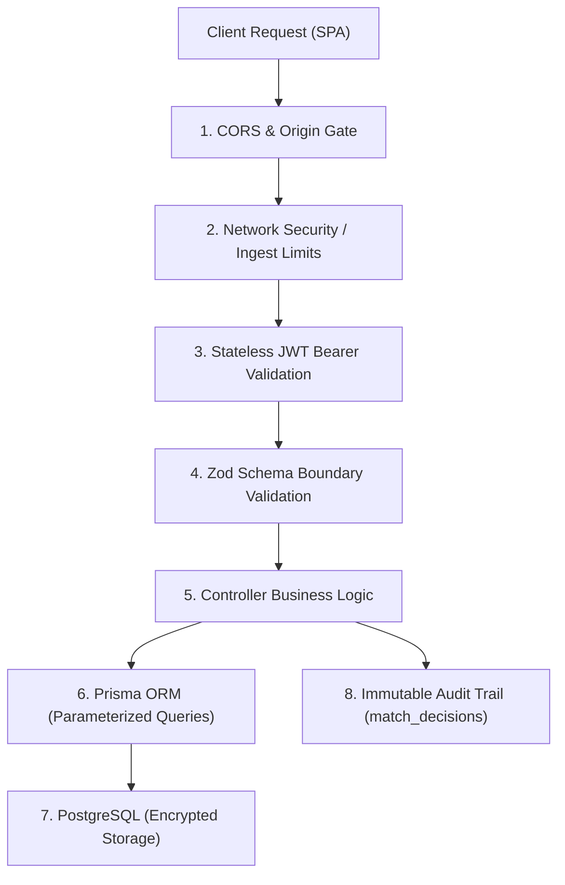

# Security & Data Governance Architecture — SANGAM

**Product Name:** Sangam  
**Tagline:** Where Travel Inventory Comes Together  
**Document Version:** 1.1.0  
**Status:** Canonical Security Specification  
**Last Updated:** November 2026  
**Related Documents:** [ARCHITECTURE.md](ARCHITECTURE.md) • [API.md](API.md) • [DATABASE.md](DATABASE.md)

---

## 1. Security Architecture Overview

Sangam processes commercial pricing, wholesale contracts, and proprietary supplier feeds across global travel distributors. Security is designed with defense-in-depth principles across authentication, request boundary sanitization, database privilege isolation, and immutable audit trails.



---

## 2. Authentication & Credential Management

### 2.1 Password Storage & Hashing
- **Algorithm:** Passwords are never stored in plaintext. They are hashed using `bcryptjs` with a work factor of $10$ salt rounds.
- **Enforcement in Code (`server/src/modules/auth/auth.routes.ts`):**
  ```typescript
  const passwordHash = await bcrypt.hash(password, 10);
  const user = await prisma.user.create({
    data: { email, passwordHash, name, role: role || 'ANALYST' },
    select: { id: true, email: true, name: true, role: true, createdAt: true },
  });
  ```
- **Password Exclusion:** The `passwordHash` field is explicitly excluded from user API responses using Prisma's `select` projection.

### 2.2 JWT Session Tokens
- **Algorithm:** `HS256` signed JSON Web Tokens using a server-side symmetric secret (`JWT_SECRET`).
- **Token Payload:** Contains `userId`, `email`, and `role`. It contains no sensitive financial or credential data.
- **Expiration Policy:** Tokens are configured with a strict expiration window (`JWT_EXPIRES_IN=7d`).
- **Client Storage:** Managed in `localStorage` with automated purge on $401\text{ Unauthorized}$ interceptor events.

### 2.3 Role-Based Access Control (RBAC)
Sangam enforces three distinct authorization tiers:

| Role | Permissions | Restricted Actions |
|---|---|---|
| **`ADMIN`** | Full access to user registration, supplier creation, configuration overrides, and audit trails. | None. |
| **`ANALYST`** | Reviewing pending queues, applying `CONFIRM`/`REJECT`/`SPLIT` match decisions, triggering re-ranking. | Cannot manage platform users or alter root system settings. |
| **`VIEWER`** | Read-only browsing of inventory, canonical entities, analytics, and comparison matrices. | Cannot execute match decisions or register suppliers. |

---

## 3. Boundary Defense & Input Validation

### 3.1 Zod Runtime Validation
All incoming HTTP request payloads are strictly validated before hitting route controllers using reusable middleware (`server/src/middleware/validate.ts`):
- Any extraneous or unexpected fields are stripped or rejected.
- String lengths, UUID formats, numeric bounds, and email syntaxes are validated at runtime.
- Malformed inputs trigger an early `400 Bad Request` with structured error feedback, preventing SQL injection or injection into downstream Python microservices.

### 3.2 FastAPI Pydantic Validation
The Python Intelligence service enforces validation via Pydantic v2 schemas:
- Numeric bounds on confidence thresholds ($0.0 \dots 1.0$) and latitude/longitude ranges are enforced via Pydantic `Field(ge=..., le=...)`.
- Strict typing prevents arbitrary code execution or unhandled numeric casting exceptions.

---

## 4. API & Network Security

### 4.1 Cross-Origin Resource Sharing (CORS)
- In development, CORS is configured via Express middleware.
- In production SaaS deployment, CORS origin is locked to verified distributor domains specified via `CORS_ORIGIN`.

### 4.2 Payload Size Limits
- Inbound body parsers are restricted to prevent Denial-of-Service (DoS) memory exhaustion:
  ```typescript
  app.use(express.json({ limit: '10mb' }));
  app.use(express.urlencoded({ extended: true, limit: '10mb' }));
  ```

### 4.3 Information Disclosure Prevention
- **Centralized Error Handling (`server/src/middleware/errorHandler.ts`):**
  - In `production`, internal database error messages and stack traces are suppressed from API responses:
    ```typescript
    return res.status(statusCode).json({
      success: false,
      message,
      ...(process.env.NODE_ENV === 'development' ? { stack: err.stack } : {}),
    });
    ```

---

## 5. Database Security & Query Safety

### 5.1 SQL Injection Protection
- All database queries are executed via **Prisma ORM**, which internally utilizes parameterized queries and prepared statements.
- Direct raw SQL queries (such as `$queryRaw` in `/health`) use tagged template literals that parameterize input values, preventing SQL injection.

### 5.2 Non-Destructive Data Isolation
- Inbound wholesale feeds are stored in isolated `supplier_listings` records with foreign key relationships.
- Overwriting or dropping supplier records is programmatically prohibited.
- Nullable foreign keys ensure that unconfirmed or rejected listings do not corrupt the verified canonical product catalog.

---

## 6. Audit Trails & Governance

### 6.1 Immutable Match Decision Logs
Every automated and manual deduplication action generates an immutable record in `match_decisions`:
- `sourceListingId`: The exact supplier listing examined.
- `targetCanonicalId`: The canonical product linked or created.
- `decision`: `AUTO_ACCEPT`, `MANUAL_CONFIRM`, `MANUAL_REJECT`, or `SPLIT`.
- `confidenceScore`: Exact score calculated at decision time.
- `explanation`: Decomposed score components (RapidFuzz score, Haversine distance, analyst notes).
- `decidedByUserId`: Foreign key to `users.id` identifying the human reviewer (or null if automated).
- `decidedAt`: Timestamp recording when the decision took effect.

---

## 7. Current vs. Planned Security Matrix

| Security Domain | Current Implementation (MVP) | Planned Implementation (Phase 2 / SaaS) |
|---|---|---|
| **Authentication** | JWT signed with symmetric secret (`HS256`) | Asymmetric key signing (`RS256`), Refresh token rotation, SSO / SAML / Okta integration |
| **API Rate Limiting** | Body size limits ($10\text{MB}$) | Token bucket rate limiting (via `express-rate-limit` + Redis) per API key |
| **Secrets Management** | Local `.env` files (Git ignored) | AWS Secrets Manager / HashiCorp Vault / Doppler automated rotation |
| **Database Access** | Username / Password connection string | IAM database authentication + SSL/TLS connection termination |
| **Multi-Tenancy** | Single-tenant with RBAC roles | Multi-tenant schema or row-level security (RLS) isolating competing OTAs |
| **Audit Logging** | PostgreSQL `match_decisions` table | Tamper-evident append-only log streaming to AWS CloudWatch / Datadog |
| **Compliance** | Internal data privacy standards | SOC 2 Type II certification, GDPR compliance for EU traveler metadata |

---

## 8. Related Documentation Links

- [System Architecture](ARCHITECTURE.md)
- [Database Schema Reference](DATABASE.md)
- [API Reference](API.md)
- [Developer Setup Guide](SETUP.md)
